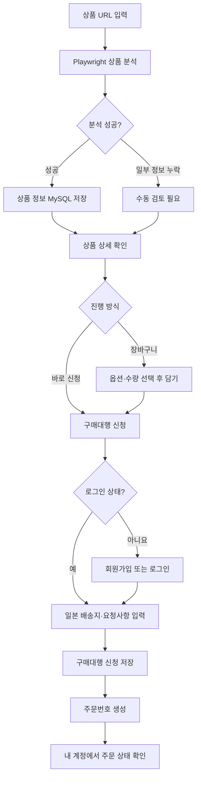

# GlobalDirect

GlobalDirect는 해외 쇼핑몰 상품 URL을 분석하고, 한국 상품의 일본 구매대행 신청 흐름을 검증하기 위한 Docker 기반 MVP입니다.

고객은 상품 URL을 입력해 상품명, 가격, 이미지와 옵션을 확인하고 장바구니에 담거나 구매대행을 신청할 수 있습니다. 회원가입과 로그인, 일본 배송지 입력, 주문 생성 및 내 주문 조회까지 구현되어 있습니다.

> [!IMPORTANT]
> 이 프로젝트는 개발·검증용 MVP입니다. 실제 쇼핑몰 주문, 결제, 배송사 API 및 운영자 처리는 연결되어 있지 않습니다. 화면의 예상 금액과 주문 상태를 실제 청구 또는 배송 결과로 사용하지 마세요.

## 주요 기능

- Playwright Chromium을 이용한 외부 상품 페이지 분석
- JSON-LD, Open Graph 및 DOM 기반 상품명·가격·이미지·옵션 추출
- 분석한 상품과 원본 응답 스냅샷의 MySQL 저장
- 세션 기반 장바구니와 상품별 옵션·수량·요청사항 저장
- 회원가입, 로그인, 로그아웃 및 로그인 세션 확인
- 일본 배송지를 포함한 구매대행 신청
- 로그인 사용자의 주문 목록 조회
- 주문 상태 이력 및 허용된 상태 전이 모델
- Redis 기반 상품 분석 진행 상태 캐시
- Docker Compose 기반 로컬 실행
- 배포용 Docker 이미지 빌드 및 TAR 반출 스크립트

## 현재 지원 범위와 제한사항

상품 분석기는 특정 쇼핑몰의 공식 API가 아니라 공개 웹페이지를 읽습니다. 사이트 구조 변경, 로그인 요구, 지역 제한 및 자동화 접근 차단에 따라 결과가 누락되거나 실패할 수 있습니다.

- 일반 상품 페이지: 구조화 데이터, 메타 태그와 DOM을 순서대로 확인합니다.
- Rakuten: JPY 가격과 구매 방식 옵션 등 일부 사이트 특화 정규화를 적용합니다.
- Coupang: 자동화 요청이 HTTP 403으로 차단되면 상품 ID만 보존하고 `needs_review` 상태로 저장합니다. 이 경우 가격, 이미지와 옵션은 자동으로 확보되지 않습니다.
- 가격 통화: 주문 예상액 계산은 `KRW`와 `JPY`만 처리합니다. 알 수 없는 통화는 예상 금액이 0이 될 수 있으므로 수동 검토가 필요합니다.
- 환산: 현재 KRW 상품가는 코드에 지정된 고정 환산값 `9.15 KRW/JPY`로 단순 환산합니다. 실시간 환율이 아닙니다.
- 주문: 신청 내용을 `review_pending` 상태로 저장할 뿐 실제 판매처 주문이나 결제는 실행하지 않습니다.
- 배송: 검사 및 배송 데이터 구조는 있지만 배송사 연동과 운영 화면은 구현되어 있지 않습니다.

## 사용자 흐름

1. 홈 화면에서 외부 상품 URL을 입력합니다.
2. PHP 애플리케이션이 내부 Playwright 서비스에 분석을 요청합니다.
3. 분석 결과가 MySQL에 저장되고 상품 상세 화면으로 이동합니다.
4. 상품 옵션과 수량을 선택해 장바구니에 담거나 구매대행 신청 화면으로 이동합니다.
5. 회원가입 또는 로그인 후 일본 배송지와 요청사항을 입력합니다.
6. 신청이 접수되면 주문번호와 예상 JPY 금액이 생성됩니다.
7. 내 계정에서 본인의 주문 목록과 현재 상태를 확인합니다.



## 기술 스택

| 영역 | 기술 |
| --- | --- |
| 웹 애플리케이션 | PHP 8.3, PHP-FPM, 의존성 없는 경량 라우팅 |
| 프런트엔드 | Vanilla JavaScript, CSS |
| 웹 서버 | Nginx 1.27 Alpine |
| 상품 분석 | Node.js, Playwright 1.63, Chromium |
| 데이터베이스 | MySQL 8.4 |
| 캐시 | Redis 7.4, AOF 활성화 |
| 실행 환경 | Docker Compose |

## 시스템 구성

```text
Browser
  │ http://localhost:8088
  ▼
Nginx
  ├─ /assets/* ──────────────► 정적 파일
  └─ /* ─────────────────────► PHP-FPM
                                 ├─ MySQL: 사용자, 상품, 장바구니, 주문
                                 ├─ Redis: 상품 분석 진행 상태
                                 └─ 내부 HTTP
                                      ▼
                                  Playwright Worker
                                      └─ 외부 상품 페이지
```

Compose 서비스는 다음과 같습니다.

| 서비스 | 역할 | 외부 공개 |
| --- | --- | --- |
| `nginx` | 정적 파일 제공 및 PHP-FPM 프록시 | `localhost:8088` |
| `php` | 웹 화면, API, 인증 및 비즈니스 로직 | 아니요 |
| `playwright` | 상품 URL 검증 및 브라우저 분석 | 아니요 |
| `mysql` | 영속 데이터 저장 | 아니요 |
| `redis` | 분석 상태 캐시 | 아니요 |

자세한 설계 경계와 견적 모델은 [시스템 아키텍처](docs/ARCHITECTURE.md), 제품 목표와 주문 상태는 [제품 요구사항](docs/PRODUCT.md)을 참고하세요.

## 요구사항

- Docker Desktop 또는 Docker Engine
- Docker Compose v2 (`docker compose` 명령)
- 최초 이미지 빌드와 외부 상품 분석을 위한 인터넷 연결
- 기본 포트 `8088` 사용 가능 상태

Windows에서는 Docker Desktop의 Linux 컨테이너 엔진이 실행 중이어야 합니다. Docker 명령이 설치되어 있어도 엔진이 정지되어 있으면 실행할 수 없습니다.

## 빠른 시작

저장소를 받은 뒤 프로젝트 루트에서 실행합니다.

```powershell
docker compose up --build -d
docker compose ps
```

브라우저에서 다음 주소를 엽니다.

- 애플리케이션: <http://localhost:8088>
- 상태 확인: <http://localhost:8088/health>

상태 확인 API의 정상 응답 예시는 다음과 같습니다.

```json
{
  "ok": true,
  "service": "globaldirect"
}
```

MySQL이 처음 생성될 때 `database/`의 SQL 파일이 파일명 순서대로 적용됩니다. 이미 생성된 `mysql_data` volume에는 초기화 SQL이 다시 실행되지 않습니다.

## 운영 명령

### 서비스 상태와 로그

```powershell
docker compose ps
docker compose logs --tail 100
docker compose logs -f php playwright
```

### 서비스 재시작

```powershell
docker compose restart
```

### 서비스 중지와 재실행

```powershell
docker compose stop
docker compose start
```

### 컨테이너 제거

```powershell
docker compose down
```

`docker compose down`은 기본적으로 named volume을 보존합니다. `docker compose down -v`는 MySQL과 Redis 데이터를 삭제하므로 데이터 초기화가 명확히 필요한 경우에만 사용하세요.

## 화면과 API

### 화면

| 경로 | 설명 |
| --- | --- |
| `/` | 상품 URL 입력 및 분석 시작 |
| `/products/{상품ID}` | 분석된 상품, 이미지와 옵션 확인 |
| `/cart` | 현재 브라우저 세션의 장바구니 |
| `/account` | 회원가입, 로그인 및 내 주문 조회 |
| `/request?product={상품ID}` | 배송지와 요청사항을 포함한 구매대행 신청 |
| `/orders` | 주문 배송 추적 데모 화면 |

### JSON API

| 메서드 | 경로 | 설명 | 인증 |
| --- | --- | --- | --- |
| `GET` | `/health` | 애플리케이션 상태 확인 | 불필요 |
| `POST` | `/api/products/analyze` | URL 분석 및 상품 저장 | 불필요 |
| `GET` | `/api/products/{상품ID}` | 저장된 상품 조회 | 불필요 |
| `POST` | `/api/cart/items` | 장바구니에 상품 추가 | 불필요 |
| `GET` | `/api/cart` | 현재 세션의 장바구니 조회 | 불필요 |
| `POST` | `/api/register` | 회원가입 및 로그인 세션 생성 | 불필요 |
| `POST` | `/api/login` | 로그인 | 불필요 |
| `POST` | `/api/logout` | 로그아웃 | 세션 사용 |
| `GET` | `/api/session` | 현재 로그인 사용자 확인 | 세션 사용 |
| `POST` | `/api/orders` | 구매대행 신청 생성 | 필요 |
| `GET` | `/api/orders/mine` | 로그인 사용자의 주문 조회 | 필요 |

요청 예시에서 비밀번호나 운영용 토큰을 저장소에 기록하지 마세요.

```powershell
$body = @{ url = "https://example.com/product" } | ConvertTo-Json
Invoke-RestMethod `
  -Method Post `
  -Uri "http://localhost:8088/api/products/analyze" `
  -ContentType "application/json" `
  -Body $body
```

## 설정

현재 로컬 개발 기본값은 [`docker-compose.yml`](docker-compose.yml)에 선언되어 있습니다.

| 환경변수 | 사용 서비스 | 설명 | 현재 로컬 기본값 |
| --- | --- | --- | --- |
| `APP_ENV` | PHP | 실행 환경 이름 | `local` |
| `APP_DEBUG` | PHP | 개발 디버그 플래그 | `true` |
| `WORKFLOW_STAGE` | PHP | 워크플로 단계 표식 | `1` |
| `DB_HOST` | PHP | MySQL 호스트 | `mysql` |
| `DB_PORT` | PHP | MySQL 포트 | `3306` |
| `DB_NAME` | PHP | 데이터베이스 이름 | `globaldirect` |
| `DB_USER` | PHP | 데이터베이스 사용자 | `globaldirect` |
| `DB_PASSWORD` | PHP | 데이터베이스 비밀번호 | 개발용 값 |
| `REDIS_HOST` | PHP | Redis 호스트 | `redis` |
| `REDIS_PORT` | PHP | Redis 포트 | `6379` |
| `PRODUCT_WORKER_URL` | PHP | 내부 Playwright 분석 URL | `http://playwright:3000` |
| `WORKER_TOKEN` | PHP, Playwright | 내부 분석 API 공유 토큰 | 개발용 값 |

운영 환경에서는 최소한 데이터베이스 비밀번호와 `WORKER_TOKEN`을 충분히 긴 임의 값으로 교체하고, Compose 파일에 직접 커밋하지 않는 방식으로 주입해야 합니다. 현재 Compose 구성은 로컬 개발용이며 HTTPS 종단, 운영 비밀 관리, 백업과 접근 제어를 포함하지 않습니다.

`WORKFLOW_STAGE`는 Compose에 전달되지만 현재 애플리케이션 코드에서 실제 결제 단계를 실행하거나 강제하는 기능은 없습니다.

## 데이터와 주문 상태

영속 데이터는 Docker named volume에 저장됩니다.

- `mysql_data`: 사용자, 상품, 장바구니, 주문 및 상태 이력
- `redis_data`: Redis AOF와 분석 상태 캐시

기본 주문 상태 흐름은 다음과 같습니다.

```text
review_pending
  → confirmed
  → local_ordered
  → warehouse_received
  → inspected
  → international_shipping
  → customs
  → domestic_shipping
  → delivered
```

단계에 따라 `cancelled` 또는 `blocked_item`으로 전환될 수 있습니다. 현재 고객 신청 API는 주문을 `review_pending`으로 생성하며, 상태를 관리하는 운영자 API나 화면은 아직 없습니다.

## 테스트와 정적 검사

Compose 설정과 Playwright 소스 문법은 다음 명령으로 확인할 수 있습니다.

```powershell
docker compose config --quiet
docker compose run --rm playwright npm run check
```

PHP 테스트는 실행 중인 `php` 컨테이너에서 수행합니다.

```powershell
docker compose exec php php -d zend.assertions=1 -d assert.exception=1 tests/OrderWorkflowTest.php
docker compose exec php php -d zend.assertions=1 -d assert.exception=1 tests/SimpleMySqlTest.php
```

`SimpleMySqlTest.php`는 MySQL 연결을 사용하며 테스트 데이터를 트랜잭션에서 롤백합니다. 테스트 실행 전 컨테이너와 데이터베이스가 정상 상태인지 확인하세요.

## Docker 이미지 빌드 및 반출

Windows용 [`build-and-export.bat`](build-and-export.bat)은 다음 작업을 순서대로 수행합니다.

1. [`VERSION`](VERSION)의 `MAJOR.MINOR.PATCH` 형식을 검사합니다.
2. Compose 설정을 검증합니다.
3. `php`와 `playwright` 이미지를 빌드합니다.
4. Nginx, MySQL과 Redis 런타임 이미지를 받습니다.
5. 애플리케이션 이미지에 버전 태그를 추가합니다.
6. 필요한 이미지를 `globaldirect-images-{VERSION}.tar`로 저장합니다.

```powershell
.\build-and-export.bat
```

동일한 이름의 TAR 파일이 이미 있으면 덮어쓰지 않고 종료합니다. 이미지 아카이브는 용량이 크고 저장소에 커밋되지 않도록 `.gitignore`에서 `*.tar`를 제외하고 있습니다.

반출한 이미지를 다른 Docker 환경에 불러오는 예시는 다음과 같습니다.

```powershell
docker load -i .\globaldirect-images-1.0.1.tar
```

이미지를 불러오는 것만으로 소스, Compose 설정 또는 데이터 volume이 복사되지는 않습니다. 대상 환경에는 프로젝트 파일과 별도의 데이터 백업이 필요합니다.

## 프로젝트 구조

```text
GlobalDirect/
├─ public/                 # HTTP 진입점과 정적 자산
├─ views/                  # PHP 화면 템플릿
├─ src/                    # 인증, 상품, 장바구니, 주문 및 DB 로직
│  └─ Adapters/            # 외부 상품·배송 연동 인터페이스
├─ worker/                 # Playwright 상품 분석 서비스
├─ database/               # 최초 MySQL 초기화 SQL
├─ docker/                 # PHP와 Nginx 이미지/설정
├─ tests/                  # PHP 경량 테스트
├─ docs/                   # 제품 및 아키텍처 문서
├─ docker-compose.yml      # 로컬 서비스 구성
├─ build-and-export.bat    # Windows 이미지 빌드·반출 스크립트
└─ VERSION                 # 이미지 반출 버전
```

## MySQL 편의 클래스

`App\\SimpleMySql`은 기존 PDO 연결을 재사용하며 조회, 추가, 수정, 삭제, 일괄 추가, upsert, 배열 파라미터와 트랜잭션을 제공합니다.

```php
$db = new App\SimpleMySql();

$product = $db->fetchOne(
    'SELECT * FROM products WHERE public_id = :public_id',
    ['public_id' => $publicId]
);

$id = $db->insert('cart_items', [
    'cart_id' => $cartId,
    'product_id' => $productId,
    'quantity' => 1,
    'selected_options_json' => '{}',
]);
```

## 보안 참고사항

- 상품 URL은 HTTP/HTTPS만 허용하며 사용자명·비밀번호가 포함된 URL을 거부합니다.
- Playwright 분석기는 DNS 결과를 검사해 사설 IP와 로컬 네트워크 접근을 차단합니다.
- PHP와 Playwright 사이의 내부 분석 요청은 `WORKER_TOKEN`으로 확인합니다.
- 사용자 비밀번호는 PHP의 `password_hash()`로 저장합니다.
- 세션 쿠키는 `HttpOnly`와 `SameSite=Lax`를 사용하며 HTTPS 요청에서는 `Secure`를 사용합니다.
- 현재 JSON 변경 API에는 CSRF 토큰 검증이 적용되어 있지 않으므로 운영 배포 전 보완이 필요합니다.
- 분석 대상 웹페이지의 콘텐츠와 URL은 신뢰할 수 없는 외부 입력으로 취급해야 합니다.

## 아직 구현되지 않은 항목

- 실제 쇼핑몰 상품 구매 및 결제
- 실시간 환율 공급자와 관세 계산 엔진
- 운영자용 주문 검토 및 상태 변경 화면/API
- 배송사 API, 송장 추적과 고객 알림
- 주소록 관리와 개인정보 암호화
- 상품 분석 비동기 큐 소비자
- 운영용 HTTPS, 비밀 관리, 모니터링과 자동 백업
- 완전한 쇼핑몰별 분석 어댑터

이 저장소를 실제 서비스에 사용하려면 보안 검토, 개인정보 보호 설계, 이용약관 준수, 결제·환불 정책과 장애 대응 체계를 별도로 갖춰야 합니다.
